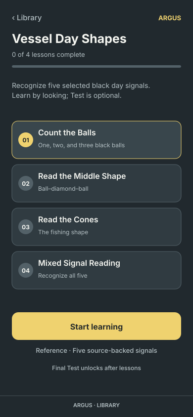
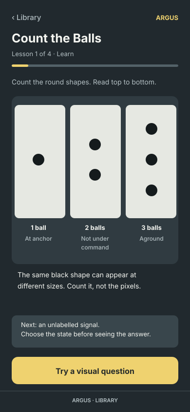
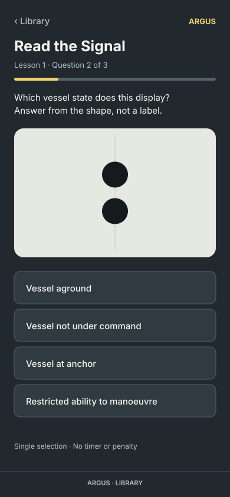
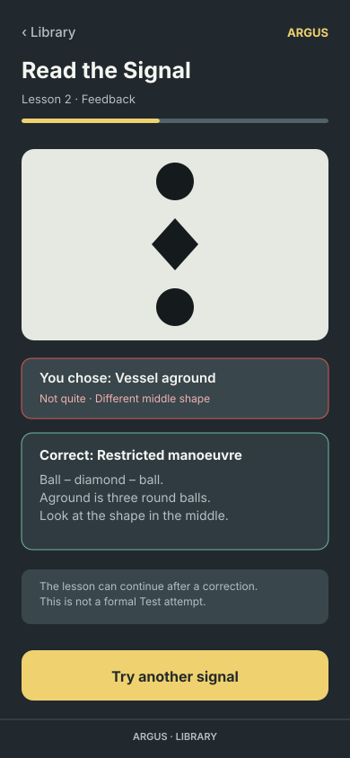
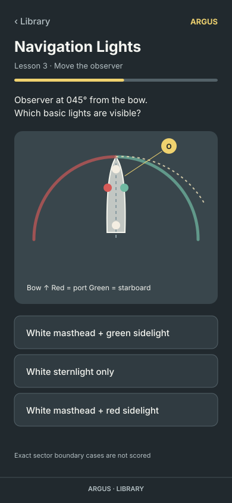
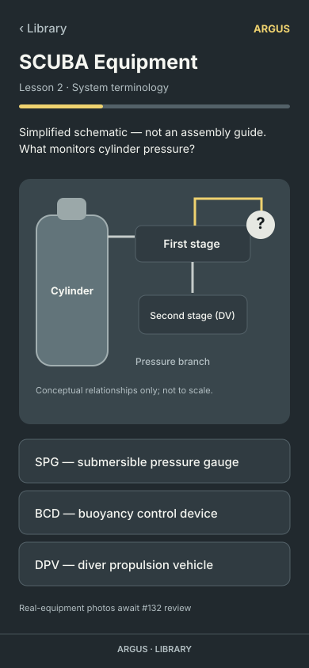
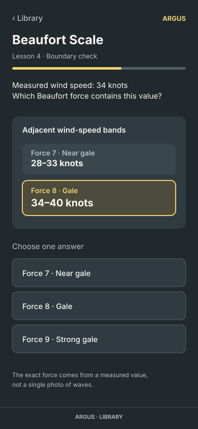
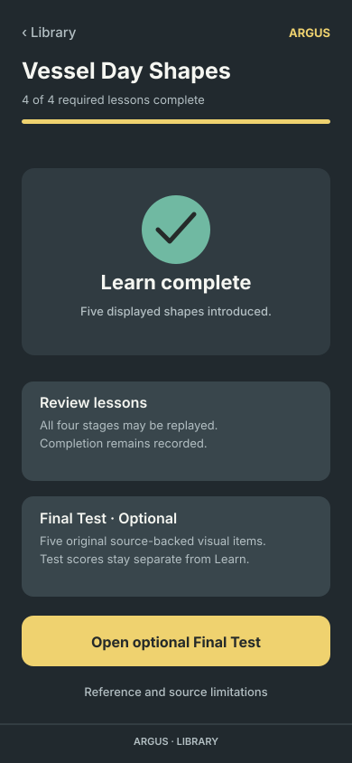

# #322 — 390px design approval gallery

Each SVG uses an exact **390 × 844 CSS-pixel** viewBox and a neutral Signal-on-Slate treatment based on the repository's DESIGN.json. They are **static source illustrations**, not rendered app screenshots, working controls, approved source art or proof of responsive implementation. Click an image for its full-size, inspectable source.

| Day Shapes topic and teaching | Visual prompt and corrected feedback |
| --- | --- |
|  |  |
|  |  |

| Related topic prototypes | Day Shapes completion |
| --- | --- |
|  |  |
|  |  |

## Approval record (pending)

- [ ] Topic path and primary action: no answer dump, no generic locked Practice.
- [ ] Teach: distinguish ball count before unlabelled active recall, keep genuine black shapes.
- [ ] Choice: 390px four large touch targets, picture precedes candidate labels.
- [ ] Wrong answer: correction explains middle diamond versus third ball; retry is formative.
- [ ] Learned state: four stages complete permanently, formal five-item Test optional.
- [ ] Lights: observer bearing and source-computed sector model align with the actual runtime source; mock is only a conceptual placement, not a verified interactive renderer.
- [ ] SCUBA: conceptual schematic only, no deployment of #132 unapproved photos or operating instructions.
- [ ] Beaufort: 34 knots falls in Force 8; 64+ convention retained; never infer a unique force from a photograph.
- [ ] After approval, implementation checks 320px, 390px, 200% text, landscape, accessibility, offline and Pixel behavior.

**Source of truth:** [curriculum](../../ISSUE_322_STAGED_CURRICULA.md), [authored step ledger](../../ISSUE_322_AUTHORED_STEP_KEYS.md), original runtime topic banks. **No shared implementation files are changed in this PR.**
